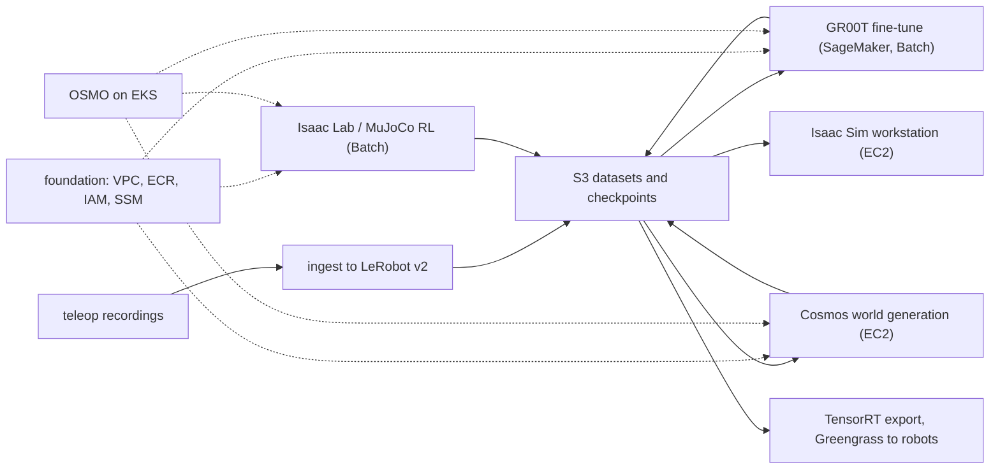
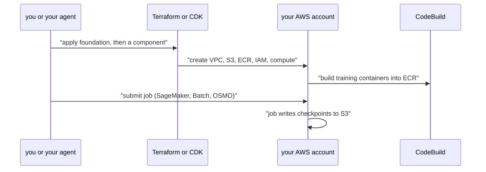

# AWS Physical AI Toolchain

A curated collection of reference architectures, Infrastructure as Code, and deployment automation for running the Physical AI stack on Amazon Web Services.


Physical AI systems — humanoid robots, autonomous mobile robots, self-driving vehicles, and smart factories — are moving from research demonstrations to production deployments. Developing these systems requires three classes of compute working in concert:

1. **High-bandwidth GPU clusters** for foundation model pre-training and post-training (fine-tuning, alignment)
2. **Elastic mid-tier GPU capacity** for simulation and software-in-the-loop validation
3. **Edge GPUs** ([NVIDIA Jetson Thor / AGX](https://developer.nvidia.com/embedded-computing)) inside the robot or at the edge for real-time inference

This toolchain provides AWS sample code for each stage, built on AWS managed services and integrated with the NVIDIA Physical AI software ecosystem.

## What it does

- Sets up the shared AWS base every stage uses: storage, container registries, roles and network.
- Fine-tunes the NVIDIA GR00T robot foundation model on your own teleoperation demonstrations.
- Generates and restyles synthetic robot video with NVIDIA Cosmos to grow a small dataset.
- Trains robot policies by reinforcement learning in Isaac Lab or MuJoCo, thousands of simulated robots at once.
- Gives you a remote GPU desktop running Isaac Sim to inspect scenes and validate policies.
- Runs the whole loop under one orchestrator, NVIDIA OSMO, when you want a single control plane.

## Screenshots

This repo is infrastructure and training code with no UI of its own, so there is nothing to screenshot. The flywheel above and the architecture diagram below are the visuals; the [workshop labs](workshop/README.md) show what each stage looks like in the AWS console and the Isaac Sim desktop.

## Physical AI Development Flywheel

Physical AI development follows a continuous improvement cycle. Each stage feeds the next, accelerating model quality with every iteration. The flywheel consists of four pillars with an **Agentic AI Orchestration Layer** at the center:

| Pillar 1 | Pillar 2 | Pillar 3 | Pillar 4 |
|----------|----------|----------|----------|
| **Synthetic Data Generation** | **Model Training** | **SIL Simulation** | **Sim-to-Real / HIL** |
| Scene composition, domain randomization, curriculum-aware augmentation | Distributed training, RL, hyperparameter search, checkpoint promotion | Physics-accurate validation, adversarial scenarios, regression gating | Domain adaptation, safety monitoring, digital twin sync, deployment scoring |
| *[Isaac Sim](https://docs.isaacsim.omniverse.nvidia.com/latest/index.html) + [Cosmos](https://www.nvidia.com/en-us/ai/cosmos/)* | *[GR00T](https://developer.nvidia.com/isaac/gr00t), [Isaac Lab](https://isaac-sim.github.io/IsaacLab/main/index.html)* | *[Isaac Sim](https://docs.isaacsim.omniverse.nvidia.com/latest/index.html)* | *[Jetson](https://developer.nvidia.com/embedded-computing) / RTX* |

**Data → Train → Validate → Deploy → Feedback → Generate** — a closed loop of continuous model improvement.

**Orchestration** spans the entire cycle — [NVIDIA OSMO](https://nvidia.github.io/OSMO/main/user_guide/index.html) coordinates task scheduling, data flow, dependency resolution, and resource allocation across heterogeneous compute.

---

## Toolchain Components

| Component | Description | Deploy (Terraform) | Get Started | Status |
|-----------|-------------|-------------------|-------------|--------|
| [**Foundation**](foundation/) | Shared S3 buckets, ECR repos, IAM roles, VPC, SSM parameters | `foundation/infra/` | [README](foundation/) | Available |
| [**Cosmos**](cosmos-on-aws/) | [NVIDIA Cosmos](https://www.nvidia.com/en-us/ai/cosmos/) world generation (Predict V2V) + data augmentation (Transfer 2.5) | `cosmos-on-aws/infra/` | Planned | Planned |
| [**Isaac Lab**](isaac-lab-on-aws/) | [NVIDIA Isaac Lab](https://developer.nvidia.com/isaac/lab) RL training (4096 parallel envs) on SageMaker + Batch | `isaac-lab-on-aws/infra/` | [README](isaac-lab-on-aws/) | Available |
| [**Isaac GR00T**](isaac-gr00t-on-aws/) | Fine-tune [NVIDIA GR00T](https://developer.nvidia.com/isaac/gr00t) N1.6 VLA model on SageMaker + Batch | `isaac-gr00t-on-aws/infra/` | [README](isaac-gr00t-on-aws/) | Available |
| [**Isaac Sim**](isaac-sim-on-aws/) | [NVIDIA Isaac Sim](https://docs.isaacsim.omniverse.nvidia.com/latest/index.html) GPU workstation for physics simulation | `isaac-sim-on-aws/infra/` | [README](isaac-sim-on-aws/) | Available |
| [**MuJoCo**](mujoco-on-aws/) | [MuJoCo](https://mujoco.org/) MJX RL training (Brax PPO, thousands of parallel envs on one GPU) on Batch + a headless sim instance, no NGC key | `mujoco-on-aws/infra/` | [README](mujoco-on-aws/) | Preview |
| [**OSMO**](osmo-on-aws/) | [NVIDIA OSMO](https://nvidia.github.io/OSMO/main/user_guide/index.html) 6.3 orchestration on EKS - control plane, compute, GPU scheduling | `osmo-on-aws/001-iac/` | [README](osmo-on-aws/) | Available |
| *Edge Deployment* | Model packaging to [Jetson](https://developer.nvidia.com/embedded-computing) via EKS Hybrid Nodes + Greengrass | Planned | - | Planned |
| *Agentic Orchestration* | AI orchestration with Strands Agents SDK + Amazon Bedrock AgentCore | Planned | - | Planned |
| *Model Evaluation* | Benchmarking, regression testing, and safety validation pipelines | Planned | - | Planned |

---

## Architecture



Teleoperation recordings (Zarr, ROS bags, CSV) are converted to LeRobot v2 and stored in the S3 buckets that `foundation/infra/` creates. GR00T fine-tuning (`isaac-gr00t-on-aws/`) reads those demonstrations on SageMaker or Batch; Cosmos (`cosmos-on-aws/`) generates new synthetic demos or restyles existing video on GPU EC2 and writes them back to S3; Isaac Lab (`isaac-lab-on-aws/`) and MuJoCo (`mujoco-on-aws/`) train policies from scratch by reinforcement learning on Batch. Checkpoints land in S3, where the Isaac Sim workstation (`isaac-sim-on-aws/`) loads them for validation and the planned edge stage exports them to TensorRT for Greengrass. The foundation's VPC, ECR repos, IAM roles and SSM parameters underpin every stage, and OSMO (`osmo-on-aws/`) can schedule all of them from one EKS control plane.


**Pipeline stages:**
1. **Ingest** — Convert teleoperation recordings (Zarr, ROS bags, CSV) to LeRobot v2 format and store in S3
2. **Train (Imitation Learning)** — Fine-tune GR00T on demonstrations via SageMaker
3. **World Generation** — Generate new synthetic demos with Cosmos 3 Predict, or restyle existing video with Cosmos Transfer 2.5
4. **Train (Reinforcement Learning)** — Train a policy from scratch in Isaac Lab (4096 parallel environments on one GPU)
5. **Deploy** — Export to TensorRT, deploy to robot fleet via Greengrass

---

## How it is deployed



There is no shared hosted service: every component deploys into your own AWS account and region (validated in `us-west-2`). The production path applies `foundation/infra/` first, then each component's `infra/` directory (OSMO uses `osmo-on-aws/001-iac/`) with Terraform. The workshop path uses the `pai` CLI (`pai deploy foundation` and friends), which deploys the CDK app in `cdk/` as CloudFormation stacks, so it needs no Terraform. Container images build in AWS CodeBuild, so no local Docker is needed. When an apply fails, the component README's troubleshooting table names the usual causes (GPU quota, Marketplace subscription, Availability Zone capacity); fix the input and apply again. To roll back, destroy the component's stack with the same tool that created it, which also stops its cost.

---

## Quick start

You need an AWS account with GPU quota (SageMaker and EC2), AWS CLI v2, Python 3.11+, Node 22+ for the CDK path, and Terraform 1.5+ for the production path. GR00T and Isaac stages also need an [NVIDIA NGC API key](https://ngc.nvidia.com/setup/api-key) and a [HuggingFace token](https://huggingface.co/settings/tokens); MuJoCo needs neither. Open Claude Code in your clone and paste this:

```text
Check that aws, python3, node and terraform are installed at the versions in README.md's
Quick start and that aws sts get-caller-identity works. Run the repo's fast checks:
python3 -m compileall -q pai, then npm ci in cdk/ and cdk/node_modules/.bin/tsc -p cdk
--noEmit, then python3 training/scripts/test_launch_mujoco_batch.py. Then in foundation/infra run
terraform init and terraform plan -var="aws_region=<my region>", show me what it would
create and what it costs per the Estimated Costs table, and ask me before any apply.
```

For a guided, no-Terraform path, follow the [workshop](workshop/README.md) from Lab 0.

---

## For agents

Read [AGENTS.md](AGENTS.md) first: how work is tracked, the commands that prove a change, the PR rules. [CONTRIBUTING.md](CONTRIBUTING.md) has the development setup.

| Path | What lives there |
|---|---|
| `foundation/` | Shared VPC, S3, ECR, IAM, SSM (Terraform) |
| `isaac-gr00t-on-aws/`, `isaac-lab-on-aws/`, `isaac-sim-on-aws/`, `mujoco-on-aws/`, `cosmos-on-aws/` | One component each: README plus `infra/` Terraform |
| `osmo-on-aws/` | OSMO on EKS (`001-iac/` Terraform) |
| `cdk/` | CDK app used by the workshop path |
| `pai/` | The `pai` CLI (`python3 -m pai`) that drives the stages |
| `containers/`, `training/` | Training images and scripts |
| `workshop/`, `notebooks/` | Lab guides and their notebooks |
| `docs/` | Runbooks and the glossary |

---

## Operations

Nothing runs until you submit work, and nothing here is a long-lived service except the OSMO control plane on EKS and an Isaac Sim workstation you leave running. Training jobs are SageMaker training jobs or AWS Batch jobs; their logs are in CloudWatch Logs and their outputs in the foundation's S3 buckets. The Isaac Sim workstation is an EC2 instance reached over DCV on port 8443; stop it when idle. Each component README carries its troubleshooting table, and the Cosmos runbook is [docs/cosmos3-validated-runbook.md](docs/cosmos3-validated-runbook.md).

---

## Status and roadmap

No `plans/` directory yet: component status is the Status column of [Toolchain Components](#toolchain-components).

---

## How It Maps to AWS

| Flywheel Stage | AWS Compute | Supporting Services |
|----------------|-------------|---------------------|
| **Synthetic Data Generation** | Amazon EC2 (G6e / L40S, P5 / H100) on EKS | Amazon S3, Amazon ECR, [NVIDIA NGC](https://catalog.ngc.nvidia.com/) |
| **Model Training** | Amazon SageMaker, AWS Batch (P5 / P6 with EFA) | Amazon S3, Amazon FSx for Lustre |
| **SIL Simulation** | Amazon EC2 (G6e GPUs) on EKS | Amazon S3, Amazon CloudWatch |
| **HIL / Edge Deployment** | EKS Hybrid Nodes (Jetson, RTX workstations) | AWS Site-to-Site VPN, AWS Direct Connect |
| **Orchestration (OSMO)** | Amazon EKS (system nodes) | Amazon RDS, ElastiCache, S3, Secrets Manager, KMS |

---

## When to Use OSMO vs. Individual Tools

This toolchain supports two usage patterns depending on where you are in your Physical AI journey:

**Use OSMO (full orchestration)** when you need an end-to-end platform that manages the entire flywheel — scheduling tasks across heterogeneous compute, resolving data dependencies between stages, and routing workloads from cloud GPUs to edge devices. OSMO is the right choice when:
- You are building a new Physical AI pipeline from scratch
- You need a single control plane to coordinate SDG, training, simulation, and deployment
- You want declarative YAML-driven workflows with automatic dependency resolution
- You need multi-cluster orchestration (cloud + on-premises lab + edge)

**Use individual tools standalone** when you already have an established orchestration pipeline (e.g., Kubeflow, Airflow, Argo Workflows, or a custom CI/CD system) and want to integrate a specific NVIDIA capability into your existing infrastructure:

| Scenario | Recommended Approach |
|----------|---------------------|
| Greenfield Physical AI platform | Start with **osmo-on-aws** — it provides orchestration + compute for all stages |
| Existing pipeline, need RL training | Deploy **isaac-lab-on-aws**, submit jobs via SageMaker or Batch |
| Existing pipeline, need imitation learning | Deploy **isaac-gr00t-on-aws**, fine-tune GR00T on your data |
| Existing pipeline, need SDG only | Deploy **cosmos-on-aws** as a standalone service |
| Existing pipeline, need edge deployment | Planned: the *Edge Deployment* component (Greengrass to Jetson) is not in the repo yet |
| Migrating from scripts to managed orchestration | Start with **osmo-on-aws**, then migrate stages incrementally |

---

## Pick and Place Example Use Case Included

The toolkit is generic infrastructure for any robot, any task, any hardware. To demonstrate it working end-to-end, we provide a complete **pick-and-place** example — the most common industrial robot task (bin picking, kitting, palletizing).

The example uses a **UR3 arm** (a popular collaborative robot in the industry) with its standard **Robotiq 2F-85 gripper** and includes 27 real teleoperation episodes. You can swap in any robot by providing your own URDF and teleop data — the pipeline stays the same regardless of embodiment or task.

---

## Estimated Costs

| Component | Cost | Notes |
|-----------|------|-------|
| GR00T training (smoke test) | ~$2 | ml.g5.12xlarge for 15 min |
| GR00T training (full) | ~$79 | ml.g5.12xlarge for 11 hrs |
| Cosmos 3 Predict | ~$37/hr | p5.48xlarge (Capacity Block) |
| Cosmos Transfer 2.5 | ~$8/hr | g6e.12xlarge (Spot) |
| Isaac Sim workstation | ~$3.00/hr | g6e.4xlarge (stop when idle) |
| Isaac Lab RL training | ~$10-30 | ml.g5.xlarge for 2-4 hrs |
| MuJoCo (Preview) | ~$1.86-3/hr | g6e.xlarge headless instance (stop when idle) or g6e.4xlarge per Batch job (scales to zero) |
| OSMO (full deployment) | ~$5/hr | EKS + RDS + ElastiCache |

All resources tear down with `terraform destroy` or `aws cloudformation delete-stack`.

---

## Who This Is For

- **Robotics engineers** building manipulation or locomotion policies
- **ML engineers** moving from cloud training to physical deployment
- **Solutions architects** designing Physical AI platforms for customers
- **Platform teams** deploying NVIDIA tools on AWS infrastructure
- **Anyone curious** about how robots learn from demonstrations and simulation

---

## Contributing

See [CONTRIBUTING.md](CONTRIBUTING.md) for setup and development notes.

## License

Apache 2.0 — see [LICENSE](LICENSE).

## Authors
- **Abhishek Srivastav** — Principal Solutions Architect, AWS
- **Steven DeVries** - Principal Solutions Architect, AWS
- **Ignacio Salvar** — Solutions Architect, AWS
- **Adam Weber** — Senior Solutions Architect, AWS
- **Gopi Krishnamurthy** - Senior Solutions Architect, AWS
